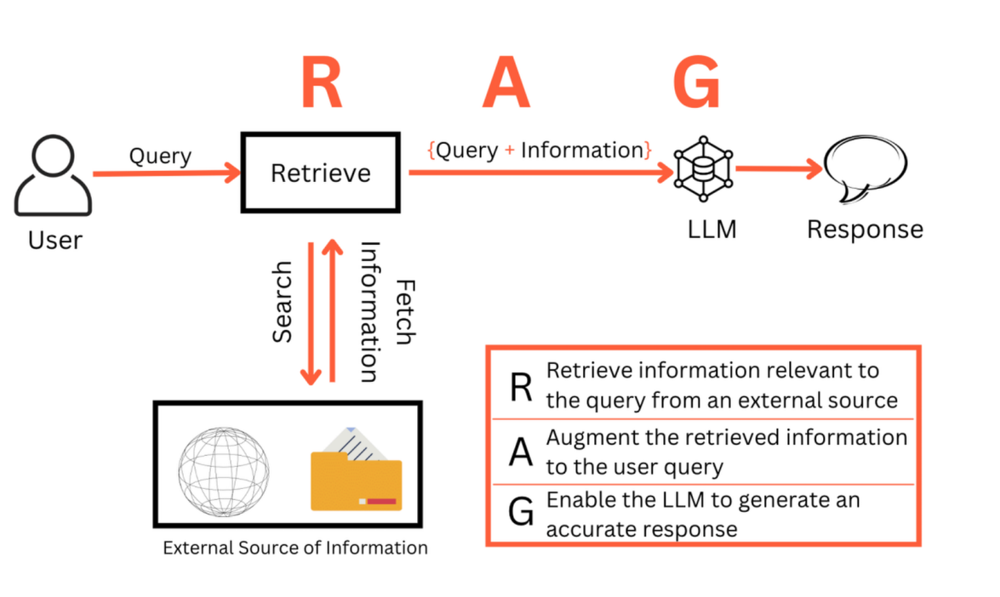
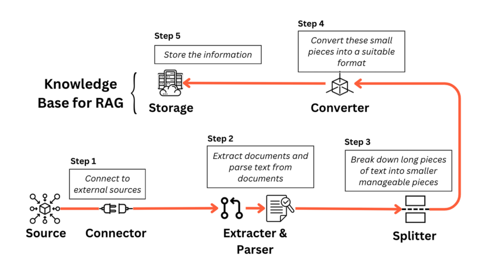
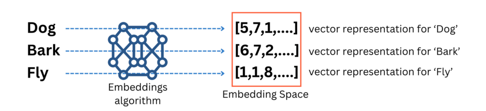
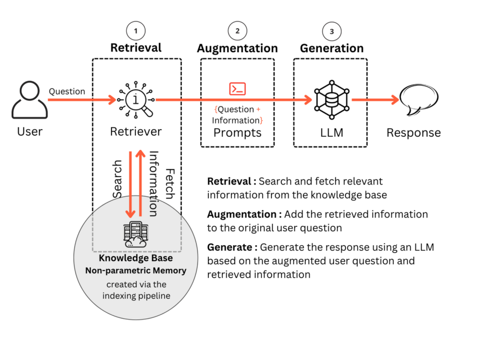
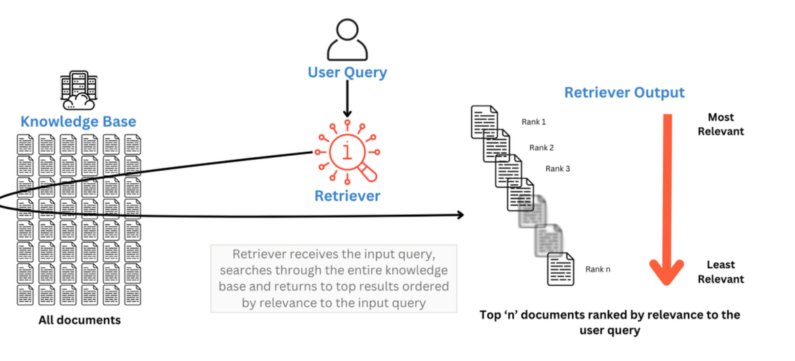

# Rag – Retrieval-Augmented Generation Service

This is a RAG model for question answering.
A production-oriented RAG backend built with **FastAPI**, **Qdrant**, and pluggable **LLM providers** (OpenAI / Cohere), designed to be **easy to extend**, **multilingual**, and **API-first**.


## 1. What is RAG?

RAG = **Retrieval-Augmented Generation**.

1. **Retrieve** relevant documents from an external knowledge base.
2. **Augment** the user query with those documents.
3. **Generate** the final answer using an LLM.

This keeps answers **grounded in your data**, reduces hallucinations, and lets you update knowledge without retraining models.




## 2. Knowledge Base & Indexing Pipeline

The project implements a full RAG knowledge base pipeline:

1. **Source & Connector** – documents come from files attached to a project.
2. **Extractor & Parser** – text is extracted and cleaned.
3. **Splitter** – long documents are split into semantically meaningful chunks.
4. **Converter (Embeddings)** – chunks are converted to dense vectors.
5. **Storage** – vectors + metadata are stored in a local **Qdrant** instance.



The embedding step maps each chunk into an embedding space, where semantic similarity becomes **vector distance**:




## 3. Retrieval & RAG Flow

At query time, the system:

1. **Embeds the user query** using the configured embedding model.
2. **Performs vector search** in Qdrant to retrieve the top-k most relevant chunks.
3. **Builds a language-specific prompt** (English / Arabic) that combines:
   - System instructions
   - Ranked retrieved documents
   - The original user query
4. **Calls the LLM** to generate a grounded answer.



The retriever ranks the chunks by relevance:




## 4. Key Features

- 🧱 **Clean architecture**
  - `LLMInterface` for generation + embeddings
  - `OpenAIProvider` & `CoHereProvider` implementations
  - `VectorDBInterface` with a `Qdrant` provider
  - `NLPController` orchestrating indexing, search, and RAG

- 🧠 **Pluggable LLM backends**
  - **Generation**: OpenAI (`gpt-3.5-turbo-0125`) or Cohere (`command-r-08-2024`)
  - **Embeddings**: OpenAI (`text-embedding-3-small`) or Cohere (`embed-multilingual-light-v3.0`)

- 🌍 **Multilingual prompt factory**
  - `EnPrompt` and `ArPrompt` (English / Arabic)
  - `RagPromptFactory` chooses the right prompt class from `language` code
  - Ensures consistent, localized system prompts and document formatting

- 📦 **Vector search with Qdrant**
  - Local Qdrant instance (file-based path)
  - Cosine or dot-product distance
  - `RetrivedfDocument` model wrapping `text` + `score`

- 🧾 **API-first design (FastAPI)**
  - Endpoints for indexing, info, semantic search, and full RAG answer
  - JSON-friendly Pydantic models (`Project`, `DataChunk`, `RetrivedfDocument`, …)

- 🔌 **Extensibility**
  - Add new LLM providers by implementing `LLMInterface`
  - Add new vector DBs by implementing `VectorDBInterface`
  - Add more languages by implementing `BasePrompt` subclasses


## 6. Getting Started

### 6.1. Create Conda environment

1) Download and install MiniConda from [here](https://docs.anaconda.com/free/miniconda/#quick-command-line-install)
2) Create a new environment using the following command:
```bash
$ conda create -n rag python=3.10
```
3) Activate the environment:
```bash
$ conda activate rag
```

### 6.2. Install dependencies

```bash
$ sudo apt update
$ sudo apt install libpq-dev gcc python3-dev
$ pip install -r requirements.txt
```

### 6.3 Setup the environment variables

```bash
$ cd docker
$ cp .env.example .env
```

### 6.4 Setup the environment variables for docker-compose

```bash
$ cp .env.example .env
```

### 6.5 when using postgres

```bash
$ cd src/models/db/postgres/alembic.ini
$ cp alembic.ini.example alembic.ini
```

Set your update variables in the `alembic.ini` with database url in  `sqlalchemy.url` value.

### 6.6 Run FastAPI server
```bash
$ uvicorn main:app --reload --host 0.0.0.0 --port 5000
```

## 7. Retrieval Workflow

This section explains how the system retrieves semantically relevant chunks from the vector database and prepares them for the RAG generation pipeline.

### 7.1 High-Level Flow
1. User sends a query.
2. Query is embedded using the embedding provider (OpenAI/Cohere).
3. Vector DB performs semantic search.
4. Top-k chunks are returned to the NLPController.
5. Chunks are assembled into a structured RAG prompt.

### 7.2 Retrieval Code Path
- `NLPController.search_vector_db_collection()`
- Embedding via `embedding_client.embed_text()`
- Search via `vectordb_client.search_by_vector()`


## 8. Detailed API Workflow (Indexing / Search / RAG Answer)


### 8.1 Indexing Chunks into the Vector Database

Endpoint:
```
POST /api/v1/nlp/index/push/{project_id}
```

Body:
```json
{ "do_reset": 1 }
```

Process:
1. Loads all chunks for the project  
2. Embeds using selected embedding backend  
3. Creates/Resets the VectorDB collection  
4. Inserts vectors + metadata  

Expected log output:
```
[RAG] indexing 9 chunks into collection_1
[RAG] embedding dim=384
```

### 8.2 Searching the Vector Database

Endpoint:
```
POST /api/v1/nlp/index/search/{project_id}
```

Body:
```json
{ "text": "what is database?", "limit": 5 }
```

Returns:
- top_k chunks  
- metadata  
- similarity scores  


### 8.3 Answering a RAG Question

Endpoint:
```
POST /api/v1/nlp/index/answer/{project_id}
```

Body:
```json
{
    "text": "what is Databases?",
    "limit": 5
}
```

Processing steps:


1. Take user query
2. Embed query
3. Retrieve top_k chunks
4. Load language-specific prompt template
5. Construct system prompt + full RAG prompt
6. Invoke selected LLM backend
7. Return grounded answer


Example answer:
```
A database is a structured collection of data...
```